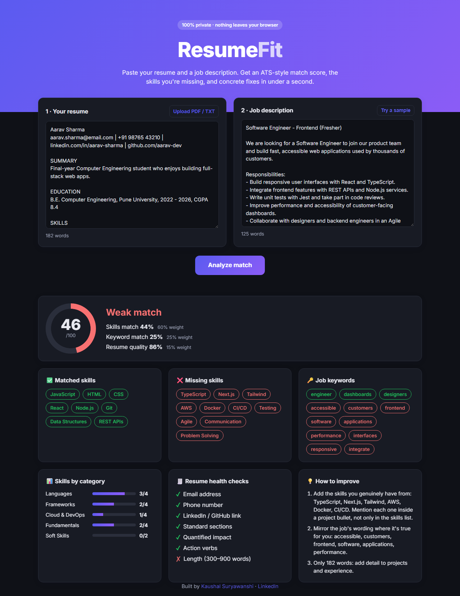

# ResumeFit · ATS Resume Checker


**Find out how well your resume matches a job before you hit "Apply".**

ResumeFit compares your resume with a job description and gives you an ATS-style match score, the skills you're missing, and specific fixes. It runs **entirely in your browser**, so your resume never leaves your device.

🔗 **Live demo:** https://kaushal-o4.github.io/resumefit/?demo



---

## Why I built this

Most companies filter resumes with Applicant Tracking Systems (ATS) before a human reads them. Many students send the same resume to every opening and never learn why they're rejected. ResumeFit shows you, for each job, what the filter is likely to see.

## Features

- **Match score (0–100)** with a breakdown of skills, keywords and resume quality
- **Matched vs missing skills** detected from a dictionary of 70+ skills and their aliases (`sklearn` → scikit-learn, `k8s` → Kubernetes)
- **Job keyword extraction** to see which important words in the job post your resume doesn't mention
- **Skills by category**: Languages, Frameworks, Data & AI, Cloud & DevOps, and more
- **Resume health checks**: contact info, LinkedIn/GitHub links, standard sections, quantified impact, action verbs, length
- **Actionable suggestions** written in plain English
- **PDF and TXT upload** (parsed locally with pdf.js)
- **Private by design**: no server, no tracking, no sign-up
- Dark mode and mobile friendly

## How the score works

| Part | Weight | What it measures |
|---|---|---|
| Skills match | 60% | Share of the job's required skills found in your resume |
| Keyword match | 25% | Share of the job's top 12 non-skill keywords (e.g. *frontend*, *accessibility*) found in your resume |
| Resume quality | 15% | Share of the 7 health checks passed |

If a job post lists no recognisable skills, the skills weight is moved to keywords.

Matching handles tricky tokens such as `C++`, `C#` and `Node.js`, and avoids false hits such as *Java* inside *JavaScript*. Keywords are lightly stemmed, so *collaborate* matches *collaborated*.

## Tech stack

- HTML, CSS, vanilla JavaScript (no framework, no build step)
- [pdf.js](https://mozilla.github.io/pdf.js/) for reading PDFs in the browser
- Node's built-in test runner for unit tests
- GitHub Actions for CI and GitHub Pages for hosting

## Project structure

```
resumefit/
├── index.html            # page layout
├── src/
│   ├── analyzer.js       # scoring engine (pure functions, runs in browser + Node)
│   ├── skills.js         # skill dictionary with aliases and categories
│   ├── app.js            # UI: inputs, PDF parsing, rendering results
│   ├── sample.js         # demo resume + job description
│   └── style.css         # styles, light/dark theme
├── tests/
│   └── analyzer.test.js  # unit tests
├── docs/                 # architecture notes, screenshot, LinkedIn post
└── .github/workflows/    # CI
```

## Run locally

```bash
git clone https://github.com/kaushal-o4/resumefit.git
cd resumefit
# open index.html in your browser, or serve it:
npx serve .
```

Run the tests (Node 18+):

```bash
npm test
```

## Roadmap

- [ ] Highlight where each skill appears in the resume
- [ ] Export the report as a PDF
- [ ] Role presets (Data Analyst, Backend, DevOps) with typical skill sets
- [ ] Optional AI rewrite of weak bullet points

## Author

**Kaushal Suryawanshi**
[GitHub](https://github.com/kaushal-o4) · [LinkedIn](https://www.linkedin.com/in/kaushal-suryawanshi-56272b32b)

If this helped you, please give it a ⭐!

## License

[MIT](LICENSE)
